# Software Requirement Specification — Supply Chain Microservice

## 1. Pendahuluan

### 1.1 Tujuan
Dokumen ini menjelaskan kebutuhan, arsitektur, fungsi setiap microservice, dan cara pembuatannya untuk sistem rantai pasok: **pembeli → retail → warehouse → supplier**, dengan distribusi barang antar lokasi dan dashboard analitik.

### 1.2 Ruang Lingkup
Sistem mencakup penjualan di retail (tunai & QRIS), pengelolaan stok, restock retail dari warehouse melalui distribusi, pemesanan warehouse ke supplier, serta dashboard penjualan, laba-rugi, dan analisis barang.

### 1.3 Asumsi
- **Bahasa pemrograman bebas per service** (tidak harus Go); service hanya terikat pada kontrak REST dan katalog event.
- **Database per service wajib RDBMS** (mis. PostgreSQL, MySQL/MariaDB). Tiap service boleh memakai RDBMS berbeda. Tipe di diagram ER (`uuid`, `enum`, `json`, `numeric`) bersifat logis dan dipetakan ke tipe setara di RDBMS terpilih (mis. `uuid` → `CHAR(36)` di MySQL).
- **Deployment tanpa Docker/Docker Compose**: **Ferron** sebagai web server/reverse proxy di depan; tiap service berjalan sebagai service systemd; **RabbitMQ** sebagai message broker.
- Pembayaran QRIS **disimulasikan** (mock provider + endpoint callback bertanda tangan).
- Nama folder `ms_01_gateaway` dan `ms_07_supplyer` dipertahankan sesuai repositori; di dokumen ditulis *Gateway* dan *Supplier*.

## 2. Skenario Bisnis
1. Pembeli masuk ke retail, memilih barang, dan membayar **tunai** atau **QRIS**.
2. **Kasir** memproses pembelian lewat POS.
3. Jika stok retail habis/menipis, **Manajer Retail** mengajukan restock ke **warehouse**; barang dikirim lewat **distribusi**.
4. Jika stok warehouse habis, warehouse memesan barang ke **supplier**.
5. **Dashboard** menampilkan rincian penjualan, laba-rugi keseluruhan dan per retail, serta analisis barang terjual.

## 3. Aktor

| Aktor | Peran |
|---|---|
| Pembeli | Memilih barang dan membayar (tidak login; dilayani kasir) |
| Kasir | Memproses penjualan & pembayaran |
| Manajer Retail | Memantau stok, mengajukan restock, menerima barang, melihat dashboard retailnya |
| Manajer Warehouse | Memproses restock, mengelola stok gudang, memesan ke supplier |
| Admin Supplier | Mengelola purchase order dan pengiriman |
| Kurir | Memperbarui status pengiriman |
| Pemilik/Admin | Master data dan dashboard keseluruhan |
| Provider QRIS (mock) | Sistem eksternal simulasi |

## 4. Arsitektur

| No | Service | Folder | Tanggung jawab | Port |
|---|---|---|---|---|
| 01 | Gateway | [ms_01_gateaway](../ms_01_gateaway/documentation/software_requirement_specification.md) | Routing, autentikasi JWT, RBAC, rate limit, audit | 8080 |
| 02 | Commodity | [ms_02_commodity](../ms_02_commodity/documentation/software_requirement_specification.md) | Master barang, kategori, harga jual & HPP | 8082 |
| 03 | Payment | [ms_03_payment](../ms_03_payment/documentation/software_requirement_specification.md) | Pembayaran tunai & QRIS | 8083 |
| 04 | Retail | [ms_04_retail](../ms_04_retail/documentation/software_requirement_specification.md) | POS, stok retail, restock request, dashboard | 8084 |
| 05 | Distribution | [ms_05_distribution](../ms_05_distribution/documentation/software_requirement_specification.md) | Pengiriman warehouse → retail | 8085 |
| 06 | Warehouse | [ms_06_warehouse](../ms_06_warehouse/documentation/software_requirement_specification.md) | Stok gudang, pemenuhan restock, pemesanan ke supplier | 8086 |
| 07 | Supplier | [ms_07_supplyer](../ms_07_supplyer/documentation/software_requirement_specification.md) | Master supplier, purchase order | 8087 |

Prinsip: *database per service*; klien hanya mengakses Gateway; komunikasi sinkron via REST untuk query, asinkron via event untuk perubahan status lintas service; referensi lintas service memakai ID logis tanpa foreign key.

Diagram: [komponen](02_component_architecture.puml), [deployment](11_deployment.puml).

### 4.1 Alasan Penggunaan Message Broker (RabbitMQ)

Perubahan status lintas service (pembayaran, restock, pengiriman, purchase order) dikirim sebagai event melalui RabbitMQ (exchange `supply.events`). Contoh: setelah QRIS dibayar, Payment menerbitkan `payment.paid` dan Retail mengonsumsinya untuk menyelesaikan penjualan serta mengurangi stok, tanpa Payment mengetahui keberadaan Retail.

**Alasan**
- **Pengembangan mandiri**: kontrak antar service hanya format event, sehingga service dapat dikembangkan paralel (bagian 10).
- **Tahan gangguan**: bila service penerima sedang tidak aktif, event tetap tersimpan di antrean dan diproses saat service kembali aktif; dengan REST sinkron, pemanggilan tersebut gagal atau hilang.
- **Proses panjang tidak memblokir**: restock, pengiriman, dan purchase order berlangsung berjam-jam hingga berhari-hari sehingga tidak cocok dikerjakan dalam satu request yang menunggu.
- **Satu event, banyak penerima**: mis. `shipment.shipped` dipakai Warehouse untuk mengurangi stok dan Retail untuk melacak status.
- **Coba ulang otomatis**: pesan yang gagal diproses dicoba ulang atau dipindahkan ke dead-letter queue.
- **Pembaruan dashboard asinkron**: `sale.completed` memperbarui tabel ringkasan tanpa memperlambat transaksi di kasir.

**Konsekuensi**
- Satu komponen tambahan yang harus dipasang dan dipantau.
- Konsistensi bersifat *eventual*: stok retail berubah beberapa saat setelah event diproses.
- Consumer wajib idempoten dan publisher memakai outbox, karena pesan dapat terkirim lebih dari sekali.

**Alternatif** (dapat dipilih bila RabbitMQ dianggap berlebihan untuk skala kecil; katalog event pada bagian 7 tidak berubah, hanya media pengirimannya):

| Alternatif | Kelebihan | Kekurangan |
|---|---|---|
| Event via REST/webhook + tabel outbox dan retry | Tanpa broker tambahan | Retry, pengiriman ke banyak penerima, dan pemantauan harus dibuat sendiri |
| Antrean berbasis RDBMS atau Redis | Lebih ringan | Fitur routing dan dead-letter terbatas |
| Kafka | Cocok untuk volume besar dan penyimpanan riwayat event | Lebih berat dioperasikan |

### 4.2 Skenario Alternatif Tanpa RabbitMQ

Bila RabbitMQ tidak digunakan, katalog event (bagian 7) tetap berlaku; hanya media pengirimannya yang berganti. Dua alternatif dipertimbangkan; **Alternatif A direkomendasikan** untuk skala 7 service pada satu server.

#### Alternatif A: Outbox + HTTP Push

Setiap service menyimpan event di tabel `outbox_events` dalam transaksi yang sama dengan perubahan datanya; worker di dalam service itu lalu mengirimkannya lewat HTTP ke service tujuan.

**Komponen**
- **Tabel `outbox_events`**: `id`, `topic`, `payload`, `status` (PENDING/SENT/DEAD), `attempts`, `next_attempt_at`.
- **Relay worker**: memeriksa tabel tiap 1–2 detik dan mengirim `POST /internal/events` ke tiap penerima dengan header `X-Event-Id` dan tanda tangan HMAC (`X-Signature`).
- **Daftar pelanggan**: konfigurasi statis per service, mis. `payment.* → http://127.0.0.1:8084`.
- **Endpoint `/internal/events`** di tiap penerima: mencatat `processed_events`, memproses event, lalu membalas 2xx.
- **Jaringan**: endpoint internal tidak melewati Ferron dan Gateway; hanya dapat diakses dari `127.0.0.1` atau jaringan privat.

**Skenario QRIS** (diagram [12](12_seq_qris_tanpa_rabbitmq.puml))
1. Callback masuk ke Payment. Dalam satu transaksi, status payment menjadi PAID dan baris `payment.paid` masuk ke outbox.
2. Relay Payment mengirim `POST /internal/events` ke Retail; balasan 2xx menandai outbox `SENT`.
3. Retail memeriksa `processed_events`: bila `event_id` sudah ada, cukup membalas 200; bila belum, sale menjadi COMPLETED, stok dikurangi, ringkasan dashboard diperbarui, dan event dicatat dalam satu transaksi.
4. Bila Retail mati atau membalas 5xx, relay mencoba ulang dengan jeda bertahap (1 dtk, 5 dtk, 30 dtk, 2 mnt, …). Setelah batas percobaan, status menjadi `DEAD` dan muncul di endpoint admin untuk ditangani.

**Perubahan pada alur lain**
- **Perintah, bukan siaran**: `shipment.requested` (Warehouse → Distribution) dan `po.requested` (Warehouse → Supplier) hanya memiliki satu penerima. Keduanya menjadi `POST` REST dengan `Idempotency-Key` yang dikirim lewat outbox yang sama agar tetap ada retry.
- **Dashboard**: `sale.completed` tidak dikirim ke mana pun; Retail memperbarui tabel ringkasan dalam transaksi yang sama saat sale menjadi COMPLETED.
- **Urutan event**: payload membawa `version`/`sequence` per entitas agar event yang datang terlambat (mis. `shipment.delivered` sebelum `shipment.shipped`) ditolak atau ditunda.
- **Pemulihan**: penerbit menyediakan `GET /internal/events?after=<cursor>` agar penerima yang lama mati dapat mengejar event yang terlewat.

#### Alternatif B: Redis Streams

Redis berperan sebagai broker ringan: tiap service memiliki consumer group, mengonfirmasi pesan dengan `XACK`, dan pesan yang tidak dikonfirmasi diambil ulang (`XAUTOCLAIM`). Syarat RDBMS hanya berlaku untuk database service, sehingga Redis sebagai broker tidak melanggarnya. Perubahannya paling kecil dari desain sekarang: outbox, idempotensi, dan katalog event tetap, hanya klien RabbitMQ yang diganti.

#### Perbandingan

| Aspek | RabbitMQ (desain saat ini) | A: Outbox + HTTP push | B: Redis Streams |
|---|---|---|---|
| Komponen tambahan | Broker | Tidak ada | Redis |
| Jaminan pengiriman | At-least-once | At-least-once | At-least-once |
| Penerbit mengetahui penerima | Tidak | Ya (konfigurasi pelanggan) | Tidak |
| Menambah penerima baru | Mudah | Ubah konfigurasi penerbit | Mudah |
| Penerima mati | Pesan menunggu di antrean | Retry relay, lalu DEAD | Pesan menunggu di stream |
| Pemantauan | Panel manajemen RabbitMQ | Dibuat sendiri (endpoint admin) | Perintah Redis atau dibuat sendiri |
| Cocok untuk | Skala menengah ke atas | Skala kecil | Skala kecil hingga menengah |

**Yang hilang pada Alternatif A**: pelepasan hubungan antara penerbit dan penerima (penerbit harus tahu alamat penerima), satu tempat pemantauan seluruh pesan, dan beban retry berada di tiap service.

## 5. Kebutuhan Fungsional

| ID | Kebutuhan | Service |
|---|---|---|
| FR-01 | Login, token JWT, otorisasi per peran | Gateway |
| FR-02 | CRUD barang, kategori, riwayat harga | Commodity |
| FR-03 | Pembuatan penjualan multi-item, validasi stok | Retail |
| FR-04 | Pembayaran tunai dengan perhitungan kembalian | Payment |
| FR-05 | Pembayaran QRIS (QR dinamis, kedaluwarsa, callback, idempotensi) | Payment |
| FR-06 | Pengurangan stok retail setelah pembayaran PAID | Retail |
| FR-07 | Peringatan stok minimum dan pengajuan restock | Retail |
| FR-08 | Pemrosesan restock: reserve stok gudang | Warehouse |
| FR-09 | Pembuatan & pelacakan pengiriman | Distribution |
| FR-10 | Penerimaan barang di retail menambah stok | Retail |
| FR-11 | Pemesanan ke supplier saat stok gudang habis | Warehouse, Supplier |
| FR-12 | Penerimaan barang supplier (goods receipt) | Warehouse |
| FR-13 | Dashboard penjualan keseluruhan & per retail | Retail |
| FR-14 | Dashboard laba-rugi (pendapatan − HPP) | Retail |
| FR-15 | Analisis barang: terlaris, lambat, kontribusi laba | Retail |

## 6. Kebutuhan Non-Fungsional
- **Keamanan**: JWT, RBAC, HTTPS (TLS di Ferron), hanya Ferron yang terbuka ke publik, verifikasi signature callback, password hash (bcrypt/argon2).
- **Konsistensi**: event idempoten (event_id), outbox pattern, retry + dead-letter queue.
- **Kinerja**: dashboard dibaca dari tabel ringkasan (read model), respons < 500 ms.
- **Ketersediaan & observability**: health check `/healthz`, log terstruktur, correlation-id.
- **Keterlacakan**: audit log di Gateway, `stock_movements` di Warehouse.

## 7. Katalog Event (exchange `supply.events`, topic)

| Event | Publisher | Consumer | Isi utama |
|---|---|---|---|
| `payment.paid` | Payment | Retail | sale_id, payment_id, amount |
| `payment.failed` | Payment | Retail | sale_id, reason |
| `sale.completed` | Retail | Retail (dashboard) | sale_id, retail_id, items(qty, price, cost) |
| `retail.stock.low` | Retail | (notifikasi) | retail_id, commodity_id, qty |
| `restock.requested` | Retail | Warehouse | restock_request_id, retail_id, items |
| `warehouse.stock.insufficient` | Warehouse | Warehouse | restock_request_id, items |
| `shipment.requested` | Warehouse | Distribution | restock_request_id, warehouse_id, retail_id, items |
| `shipment.created / shipped / delivered` | Distribution | Retail, Warehouse | shipment_id, restock_request_id |
| `po.requested` | Warehouse | Supplier | warehouse_id, supplier_id, items |
| `po.confirmed / shipped / delivered` | Supplier | Warehouse | po_id |

## 8. Diagram

| Jenis | File |
|---|---|
| Use case | [01_usecase.puml](01_usecase.puml) |
| Komponen | [02_component_architecture.puml](02_component_architecture.puml) |
| ER global | [03_er_diagram_global.puml](03_er_diagram_global.puml) |
| Sequence pembelian tunai | [04](04_seq_pembelian_tunai.puml) |
| Sequence pembelian QRIS | [05](05_seq_pembelian_qris.puml) |
| Sequence restock retail → warehouse → distribusi | [06](06_seq_restock_retail_ke_warehouse_distribusi.puml) |
| Sequence warehouse → supplier | [07](07_seq_pemesanan_warehouse_ke_supplier.puml) |
| Sequence dashboard | [08](08_seq_dashboard.puml) |
| Activity end-to-end | [09](09_activity_end_to_end.puml) |
| State | [10](10_state_order_pembayaran_distribusi.puml) |
| Deployment | [11](11_deployment.puml) |
| Sequence alternatif QRIS tanpa RabbitMQ | [12](12_seq_qris_tanpa_rabbitmq.puml) |

Render: `plantuml -tsvg documentation/*.puml`.

## 9. Panduan Pembuatan Umum

1. **Struktur proyek tiap service** (bahasa bebas; contoh netral):
   ```
   ms_0X_nama/
   ├── src/                 # handler (REST), service (aturan bisnis), repository, event
   ├── migrations/          # skrip skema RDBMS
   ├── api/openapi.yaml
   ├── config/.env.example  # DB_URL, AMQP_URL, JWT_SECRET, PORT
   ├── deploy/ms_0X_nama.service   # unit systemd
   └── documentation/
   ```
2. **Urutan implementasi**: migrasi database → model & repository → service (aturan bisnis) → handler REST → publisher/consumer event → pengujian → unit systemd.
3. **Urutan service**: tidak wajib berurutan; setiap service dapat dikembangkan paralel dengan mock (lihat bagian 10). Urutan Commodity → Payment → Retail → Warehouse → Supplier → Distribution → Gateway hanya disarankan bila ingin integrasi nyata tanpa mock.
4. **Infrastruktur (tanpa Docker)**: pasang RDBMS dan RabbitMQ sebagai paket sistem; buat satu database dan satu user per service; konfigurasi service lewat environment file (`/etc/supply-chain/<service>.env`).
5. **Menjalankan service dengan systemd** (contoh):
   ```ini
   [Unit]
   Description=ms_04_retail
   After=network.target rabbitmq-server.service

   [Service]
   EnvironmentFile=/etc/supply-chain/ms_04_retail.env
   ExecStart=/opt/supply-chain/ms_04_retail/run   # perintah sesuai bahasa yang dipakai
   Restart=on-failure
   User=supplychain

   [Install]
   WantedBy=multi-user.target
   ```
6. **Ferron sebagai web server / reverse proxy** — file `/etc/ferron/ferron.conf` (sintaks mengikuti dokumentasi Ferron 3; validasi dengan `ferron validate`):
   ```
   supply.example.com {
       # TLS otomatis (ACME) aktif secara default untuk host publik

       rate_limit {
           rate 100
           burst 50
           key remote_address
           deny_status 429
       }

       proxy {
           upstream http://127.0.0.1:8080 {
               active_check {
                   uri /healthz
                   interval "10s"
               }
           }
       }
   }
   ```
   Catatan: Ferron meneruskan semua trafik ke Gateway (`ms_01`), yang melakukan autentikasi/RBAC dan meneruskan ke service internal. Service lain hanya mendengarkan di `127.0.0.1`/jaringan privat. Callback QRIS (`/api/payment/qris/callback`) juga lewat Ferron → Gateway → Payment. Reload konfigurasi: `sudo systemctl reload ferron`. Bila Gateway dijalankan lebih dari satu instance, tambahkan beberapa `upstream` pada blok `proxy`. Bila perlu pembatasan laju lebih ketat untuk rute tertentu (mis. login), gunakan blok `location`; perhatikan bahwa `location` memotong prefix path secara otomatis sebelum diteruskan ke backend.
7. **Konvensi API**: prefix `/api/<service>/v1`, respons JSON `{data, error}`, header `X-Correlation-Id`, `Idempotency-Key` untuk POST pembayaran.
8. **Pengujian**: unit test service layer, integration test terhadap RDBMS uji (instance lokal, bukan container), contract test untuk event.

## 10. Pengembangan Paralel dan Strategi Mock

Setiap service dapat diimplementasikan dan diuji tanpa menunggu service lain, dengan syarat kontrak dibekukan terlebih dahulu.

### 10.1 Jenis ketergantungan

| Jenis | Hubungan | Cara mengembangkan mandiri |
|---|---|---|
| Event (longgar) | Payment → Retail (`payment.*`); Warehouse → Distribution (`shipment.requested`); Distribution → Retail/Warehouse (`shipment.*`); Warehouse ↔ Supplier (`po.*`) | Publikasikan/konsumsi event contoh langsung ke RabbitMQ lokal sesuai katalog event (bagian 7) |
| REST sinkron (ketat) | Retail → Commodity (harga, HPP, nama barang) | Mock server dari `api/openapi.yaml` Commodity |
| REST sinkron (ketat) | Retail → Payment (buat pembayaran) | Mock server Payment; hasil pembayaran disimulasikan dengan mempublikasikan `payment.paid` / `payment.failed` |
| REST sinkron (ketat) | Warehouse → Supplier (penawaran & harga) | Mock server Supplier |
| Routing | Gateway → semua service | Gateway tidak diperlukan saat pengembangan; kirim header `X-User-Id`, `X-Role`, `X-Retail-Id` secara manual |

### 10.2 Prasyarat (kontrak)
1. `api/openapi.yaml` tiap service ditulis dan dibekukan lebih dulu (path, skema request/response, kode galat).
2. Skema payload event (nama, field, `event_id`, versi) dibekukan sesuai bagian 7; perubahan bersifat kompatibel ke belakang.
3. Referensi lintas service memakai ID logis tanpa foreign key, sehingga tidak ada ketergantungan skema database.
4. Consumer event idempoten (`processed_events`) dan publisher memakai outbox, sehingga urutan atau pengulangan pengiriman aman.

### 10.3 Strategi pengujian
- **Tingkat service**: unit test + integration test terhadap RDBMS uji, dengan dependensi REST dimock dan event disuntikkan manual.
- **Contract test**: pemanggil (Retail, Warehouse) memverifikasi mock terhadap `openapi.yaml`; penyedia (Commodity, Payment, Supplier) memverifikasi implementasi nyata terhadap `openapi.yaml` yang sama.
- **Integrasi akhir**: setelah semua service lolos mandiri, jalankan skenario end-to-end (diagram sequence 04–08) melalui Ferron dan Gateway: penjualan tunai, penjualan QRIS, restock retail ke warehouse lewat distribusi, pemesanan ke supplier, dan dashboard.

### 10.4 Batasan
- Retail paling bergantung (Commodity dan Payment), sehingga mock-nya paling penting.
- Event mengandalkan RabbitMQ; broker lokal diperlukan bahkan untuk pengembangan mandiri.
- Mock tidak menjamin perilaku nyata; integrasi akhir tetap wajib sebelum rilis.

## 11. Matriks Peran × Akses (ringkas)

| Endpoint grup | Kasir | Mgr Retail | Mgr Warehouse | Admin Supplier | Kurir | Pemilik |
|---|---|---|---|---|---|---|
| Penjualan & pembayaran | ✔ | ✔ (lihat) | – | – | – | ✔ (lihat) |
| Restock request | – | ✔ | ✔ (proses) | – | – | ✔ |
| Stok warehouse & PO | – | – | ✔ | ✔ (PO miliknya) | – | ✔ |
| Shipment | – | ✔ (lihat) | ✔ | – | ✔ | ✔ |
| Dashboard | – | ✔ (retailnya) | – | – | – | ✔ (semua) |
| Master barang | – | – | – | – | – | ✔ |

## Lampiran Gambar Diagram

### Use Case Diagram - Supply Chain Microservice

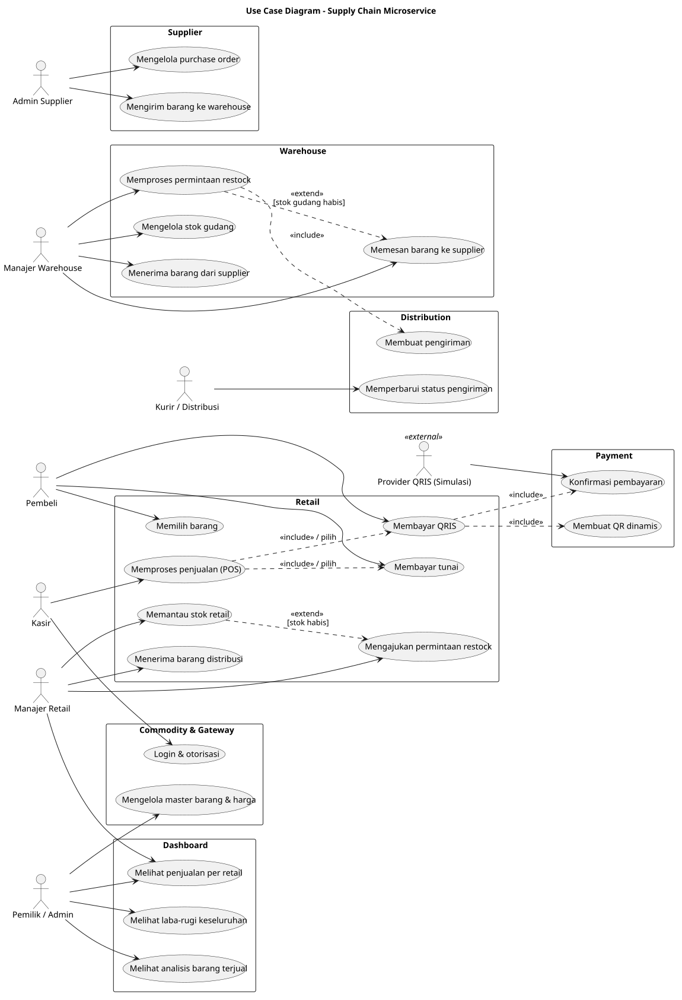

Sumber: [01_usecase.puml](01_usecase.puml)

### Arsitektur Komponen - Supply Chain Microservice

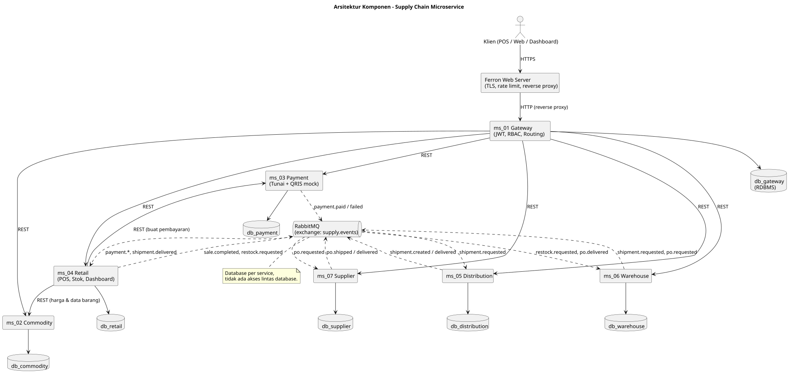

Sumber: [02_component_architecture.puml](02_component_architecture.puml)

### ER Diagram Global (gabungan seluruh service, relasi lintas service berupa referensi ID logis)

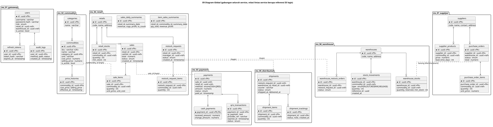

Sumber: [03_er_diagram_global.puml](03_er_diagram_global.puml)

### Sequence - Pembelian dengan Pembayaran Tunai

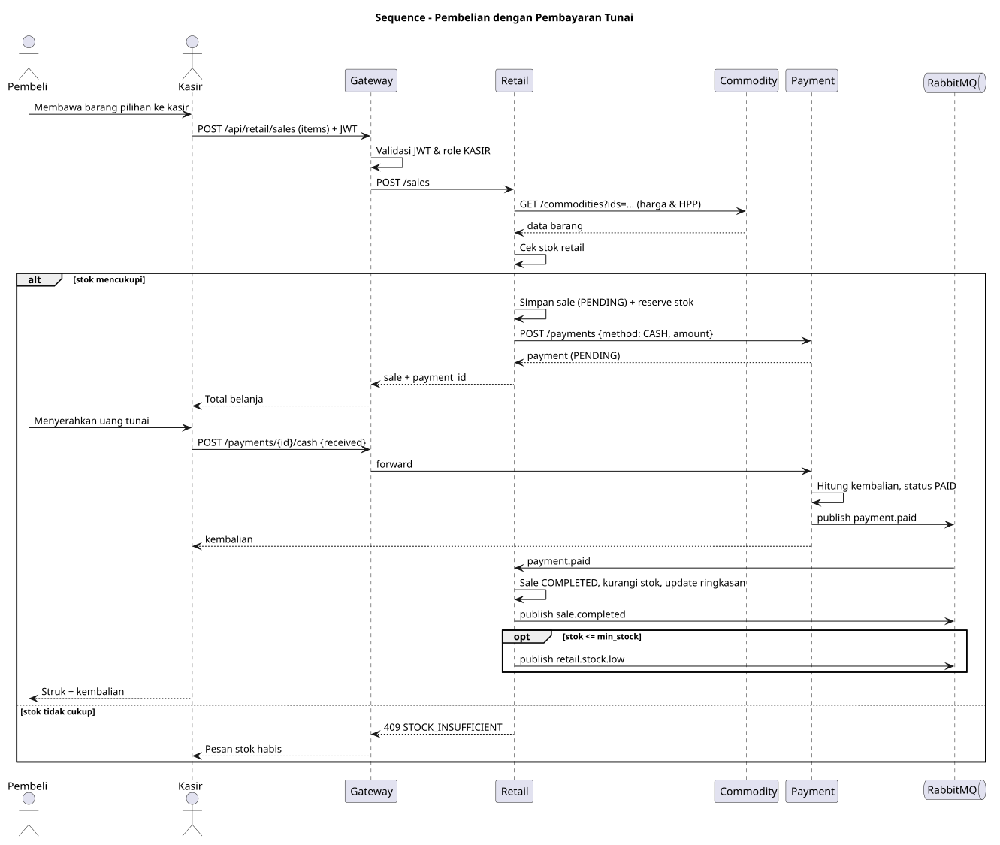

Sumber: [04_seq_pembelian_tunai.puml](04_seq_pembelian_tunai.puml)

### Sequence - Pembelian dengan Pembayaran QRIS (Simulasi)

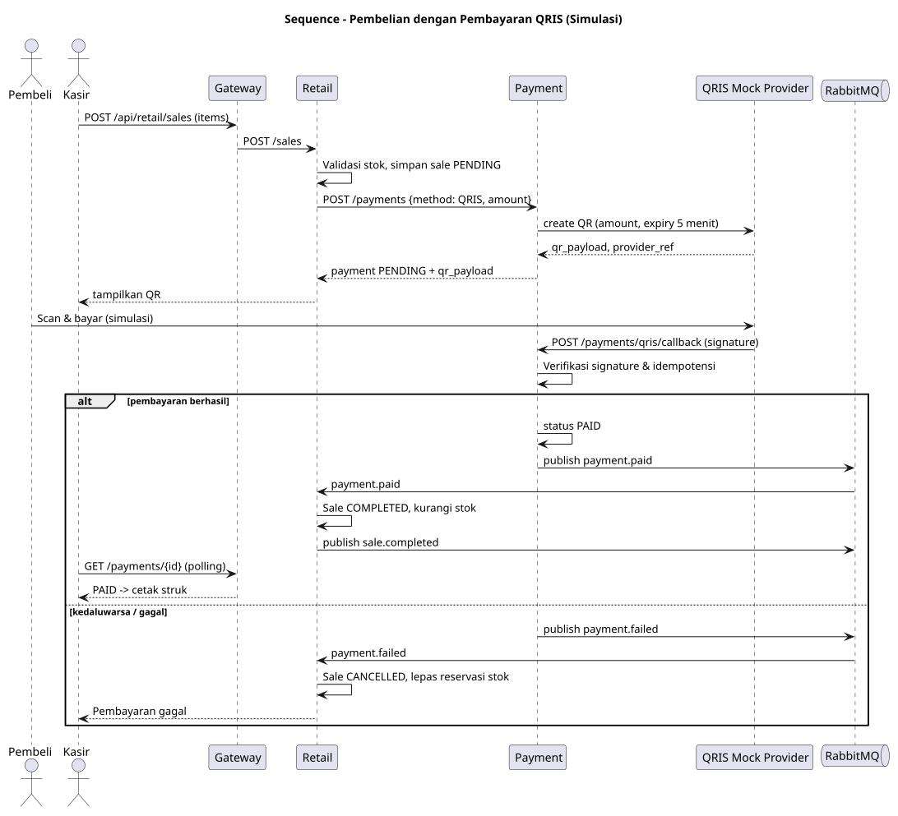

Sumber: [05_seq_pembelian_qris.puml](05_seq_pembelian_qris.puml)

### Sequence - Restock Retail dari Warehouse melalui Distribusi

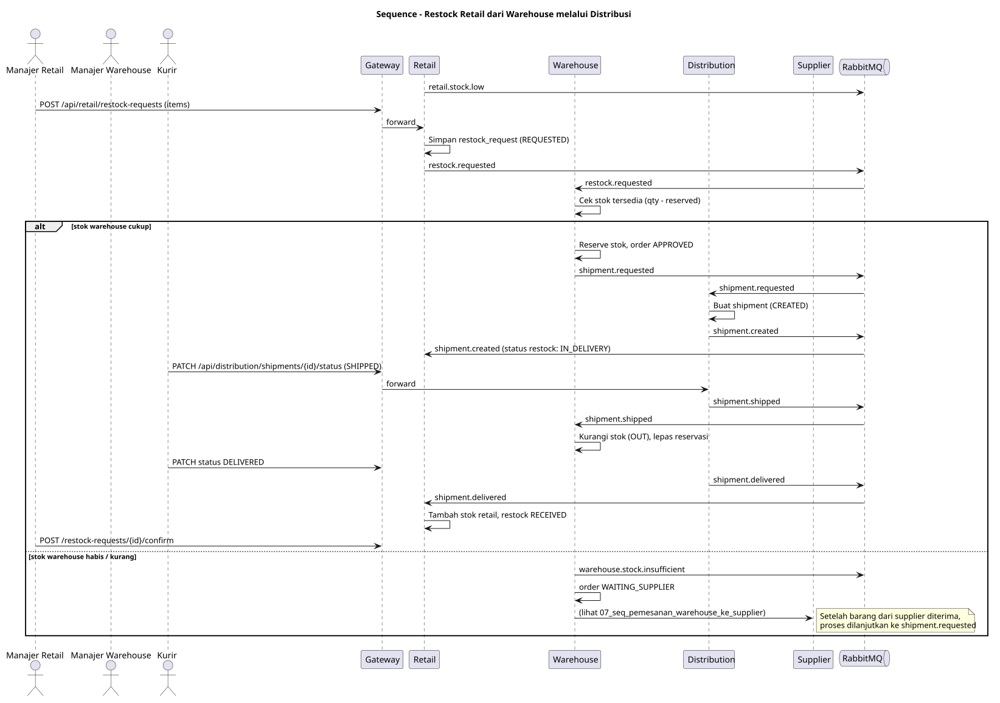

Sumber: [06_seq_restock_retail_ke_warehouse_distribusi.puml](06_seq_restock_retail_ke_warehouse_distribusi.puml)

### Sequence - Pemesanan Warehouse ke Supplier

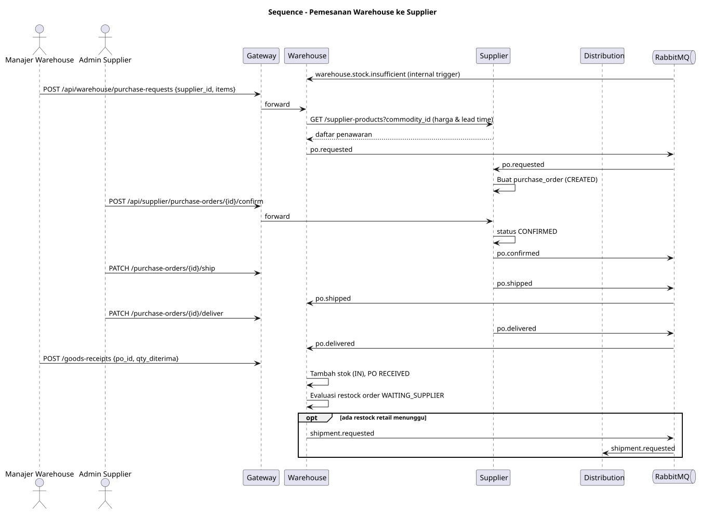

Sumber: [07_seq_pemesanan_warehouse_ke_supplier.puml](07_seq_pemesanan_warehouse_ke_supplier.puml)

### Sequence - Dashboard Penjualan, Laba-Rugi & Analisis Barang

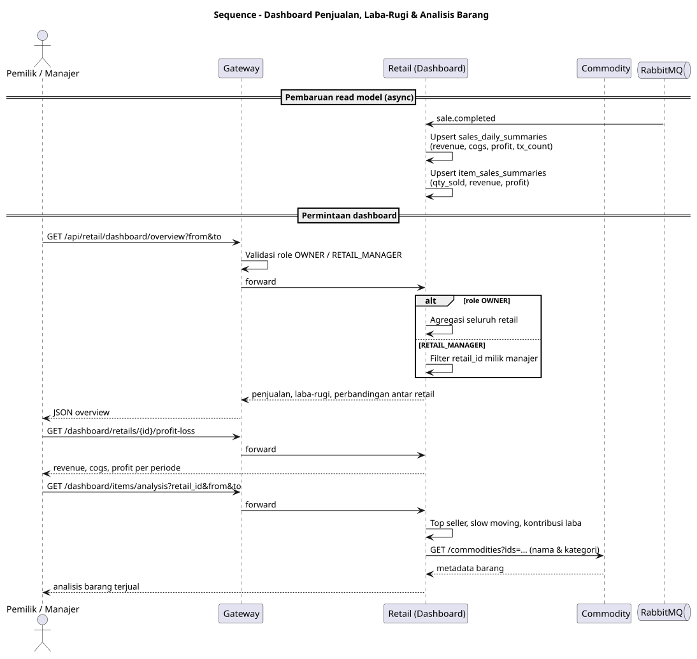

Sumber: [08_seq_dashboard.puml](08_seq_dashboard.puml)

### Activity Diagram - Alur End-to-End Supply Chain

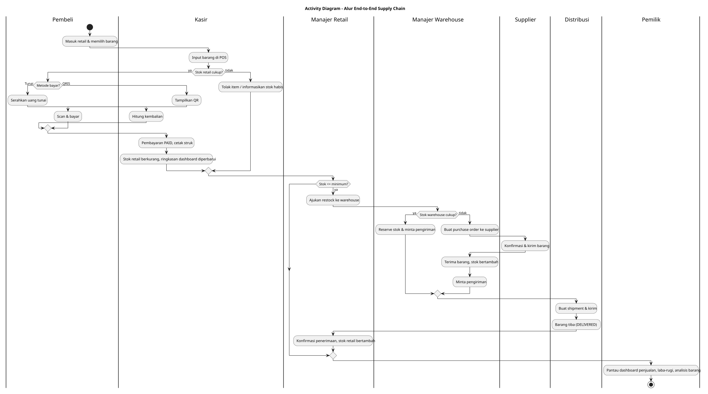

Sumber: [09_activity_end_to_end.puml](09_activity_end_to_end.puml)

### State Diagram - Sale, Payment, Restock, Shipment, Purchase Order

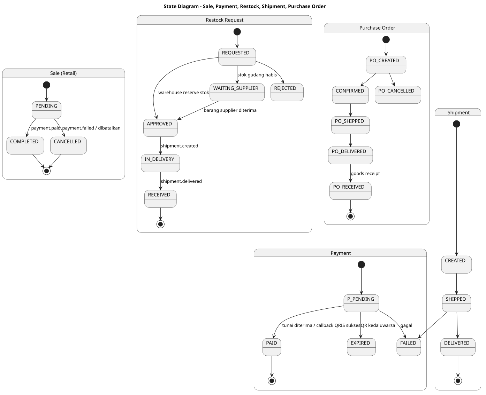

Sumber: [10_state_order_pembayaran_distribusi.puml](10_state_order_pembayaran_distribusi.puml)

### Deployment Diagram (Ferron Web Server + systemd)

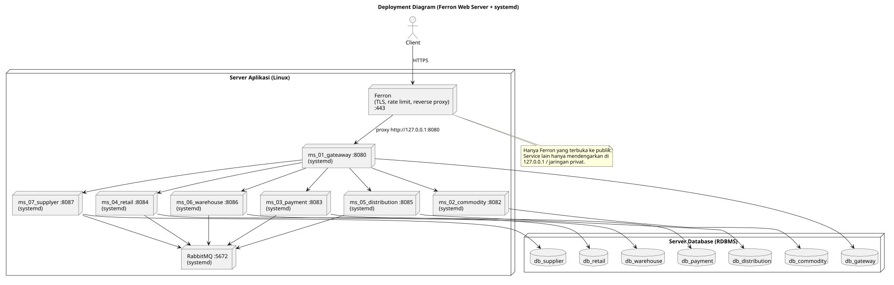

Sumber: [11_deployment.puml](11_deployment.puml)

### Sequence Alternatif - Pembayaran QRIS tanpa RabbitMQ (Outbox + HTTP Push)

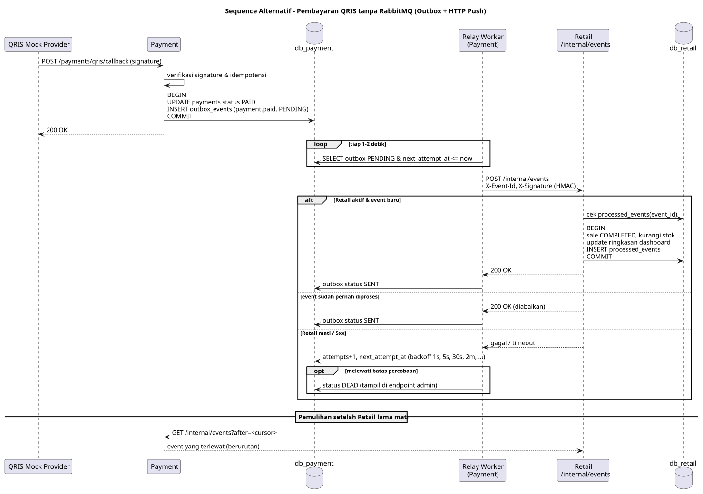

Sumber: [12_seq_qris_tanpa_rabbitmq.puml](12_seq_qris_tanpa_rabbitmq.puml)
