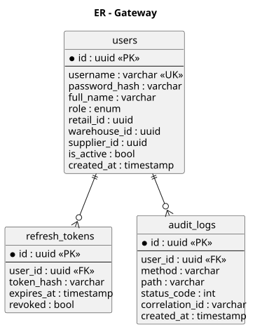
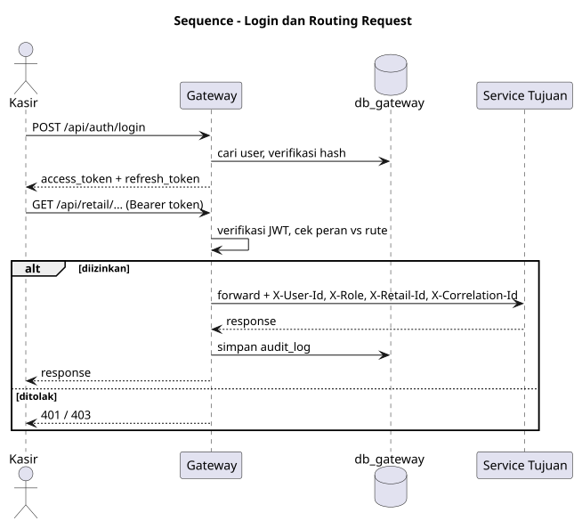
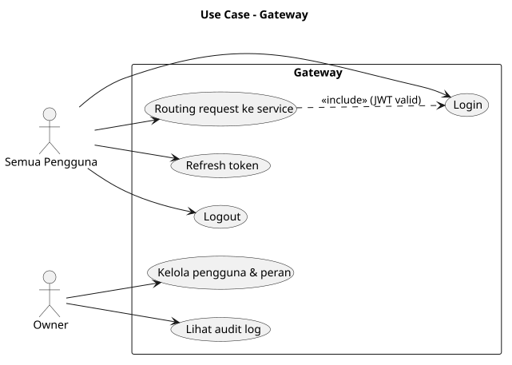

# SRS — ms_01 Gateway

## 1. Fungsi
Pintu masuk tunggal sistem: autentikasi (JWT), otorisasi berbasis peran (RBAC), routing ke service internal, rate limiting, propagasi `X-Correlation-Id`, dan audit log. Gateway juga memiliki data pengguna.

## 2. Kebutuhan
- Login/logout/refresh token; access token 15 menit, refresh token 7 hari.
- Peran: `CASHIER`, `RETAIL_MANAGER`, `WAREHOUSE_MANAGER`, `SUPPLIER_ADMIN`, `COURIER`, `OWNER`.
- Pengguna terikat `retail_id` / `warehouse_id` / `supplier_id` sesuai peran; klaim dimasukkan ke JWT.
- Routing: `/api/commodity/*`, `/api/payment/*`, `/api/retail/*`, `/api/distribution/*`, `/api/warehouse/*`, `/api/supplier/*`.
- Endpoint callback QRIS (`/api/payment/qris/callback`) bersifat publik tetapi diverifikasi signature oleh Payment.

## 3. Endpoint

| Method | Path | Deskripsi | Peran |
|---|---|---|---|
| POST | `/api/auth/login` | Login | publik |
| POST | `/api/auth/refresh` | Perbarui token | publik |
| POST | `/api/auth/logout` | Cabut refresh token | semua |
| CRUD | `/api/users` | Kelola pengguna | OWNER |
| GET | `/healthz` | Health check | publik |

## 4. Model Data
`users`, `refresh_tokens`, `audit_logs` — lihat [er.puml](er.puml).

## 5. Event
Tidak menerbitkan atau mengonsumsi event bisnis.

## 6. Diagram
[usecase.puml](usecase.puml) · [er.puml](er.puml) · [sequence_auth_routing.puml](sequence_auth_routing.puml)

## 7. Cara Pembuatan
1. Pilih bahasa/framework (bebas, mis. Go, Node.js, Java, Python, PHP, Rust) dan buat proyek `gateway` yang dijalankan sebagai service systemd di port 8080; siapkan database `db_gateway` pada RDBMS pilihan.
2. Migrasi: `users`, `refresh_tokens`, `audit_logs`.
3. Implementasi `auth` (hash bcrypt/argon2, penerbitan JWT HS256/RS256) dan CRUD user.
4. Middleware berurutan: correlation-id → logging → rate limit → verifikasi JWT → cek peran → audit.
5. Reverse proxy internal memakai pustaka HTTP bahasa yang dipilih, dengan tabel rute `prefix → upstream` dari environment variable; tambahkan header `X-User-Id`, `X-Role`, `X-Retail-Id`.
6. Seed akun OWNER awal.
7. Uji: unit test middleware, integration test login → akses endpoint terproteksi.

## Lampiran Gambar Diagram

### ER - Gateway

Sumber: [er.puml](er.puml)

### Sequence - Login dan Routing Request

Sumber: [sequence_auth_routing.puml](sequence_auth_routing.puml)

### Use Case - Gateway

Sumber: [usecase.puml](usecase.puml)
