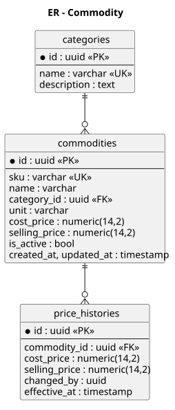
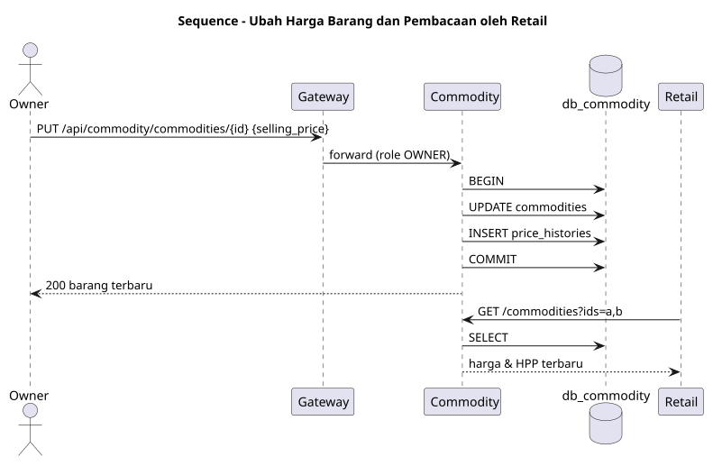
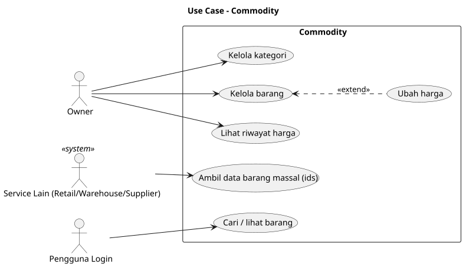

# SRS — ms_02 Commodity

## 1. Fungsi
Sumber kebenaran tunggal **master barang**: kategori, SKU, satuan, harga pokok (HPP/`cost_price`) dan harga jual (`selling_price`), beserta riwayat perubahan harga. Dipakai Retail (harga saat penjualan, HPP untuk laba-rugi), Warehouse, Supplier, dan Dashboard.

## 2. Kebutuhan
- CRUD kategori dan barang; SKU unik; barang dinonaktifkan (soft delete), tidak dihapus.
- Setiap perubahan harga mencatat `price_histories`.
- Query massal berdasarkan daftar ID (`?ids=a,b,c`) untuk menghindari N+1 dari service lain.
- Pencarian berdasarkan nama/SKU/kategori dengan paginasi.

## 3. Endpoint

| Method | Path | Deskripsi | Peran |
|---|---|---|---|
| GET | `/commodities` | Daftar/cari (`q`, `category_id`, `ids`) | semua login |
| GET | `/commodities/{id}` | Detail | semua login |
| POST | `/commodities` | Tambah barang | OWNER |
| PUT | `/commodities/{id}` | Ubah barang/harga | OWNER |
| DELETE | `/commodities/{id}` | Nonaktifkan | OWNER |
| GET | `/commodities/{id}/price-histories` | Riwayat harga | OWNER |
| CRUD | `/categories` | Kategori | OWNER |

## 4. Model Data
`categories`, `commodities`, `price_histories` — lihat [er.puml](er.puml).

## 5. Event
Opsional: menerbitkan `commodity.price.changed` (tidak wajib pada fase awal; service lain membaca harga via REST).

## 6. Aturan Bisnis
- `selling_price >= cost_price` memberi peringatan (bukan penolakan).
- Harga pada `sale_items` disalin saat transaksi (snapshot), sehingga perubahan harga tidak mengubah histori penjualan.

## 7. Diagram
[usecase.puml](usecase.puml) · [er.puml](er.puml) · [sequence_price_update.puml](sequence_price_update.puml)

## 8. Cara Pembuatan
1. Database `db_commodity`; migrasi tiga tabel, indeks pada `sku`, `category_id`, `name` (indeks pencarian teks sesuai fitur RDBMS yang dipakai, opsional).
2. Repository + service (validasi SKU unik, pencatatan riwayat harga dalam satu transaksi DB).
3. Handler REST dengan paginasi; dokumentasi `openapi.yaml`.
4. Seed data kategori & barang contoh.
5. Uji: unit test service, integration test CRUD dan query `ids`.

## Lampiran Gambar Diagram

### ER - Commodity

Sumber: [er.puml](er.puml)

### Sequence - Ubah Harga Barang dan Pembacaan oleh Retail

Sumber: [sequence_price_update.puml](sequence_price_update.puml)

### Use Case - Commodity

Sumber: [usecase.puml](usecase.puml)
