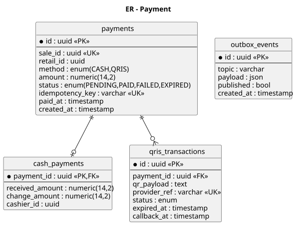
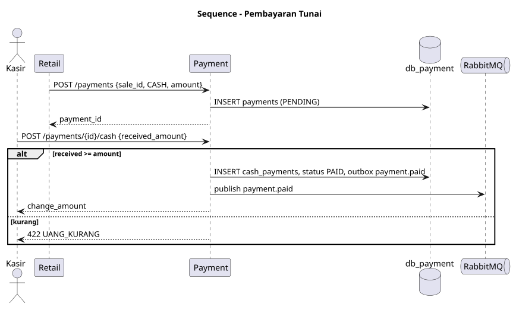
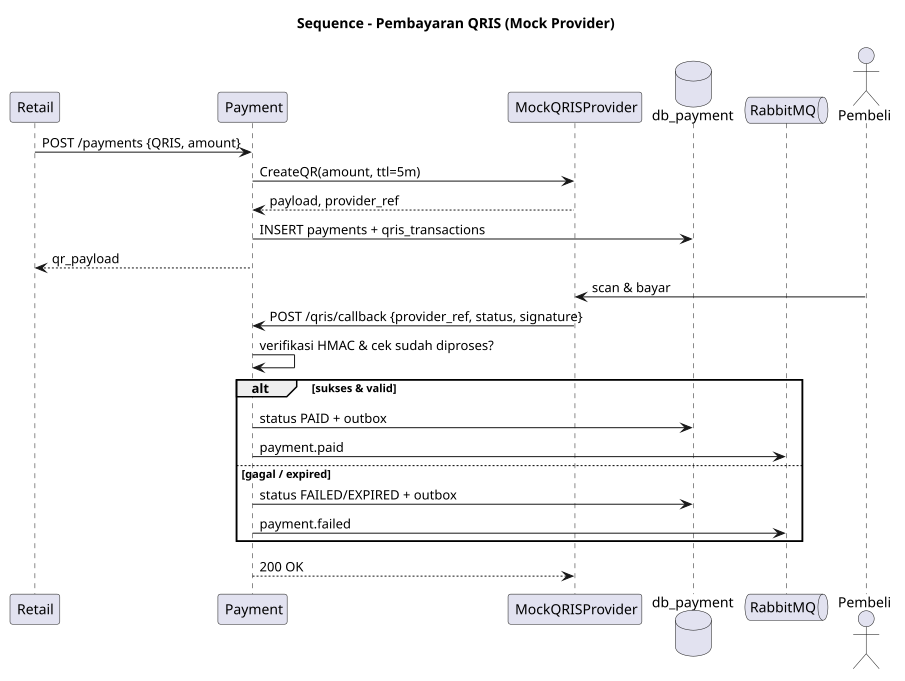
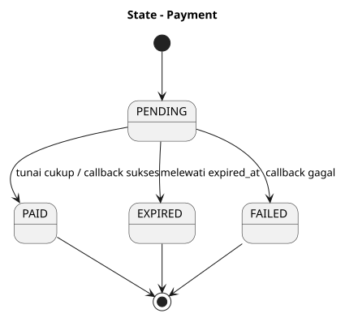
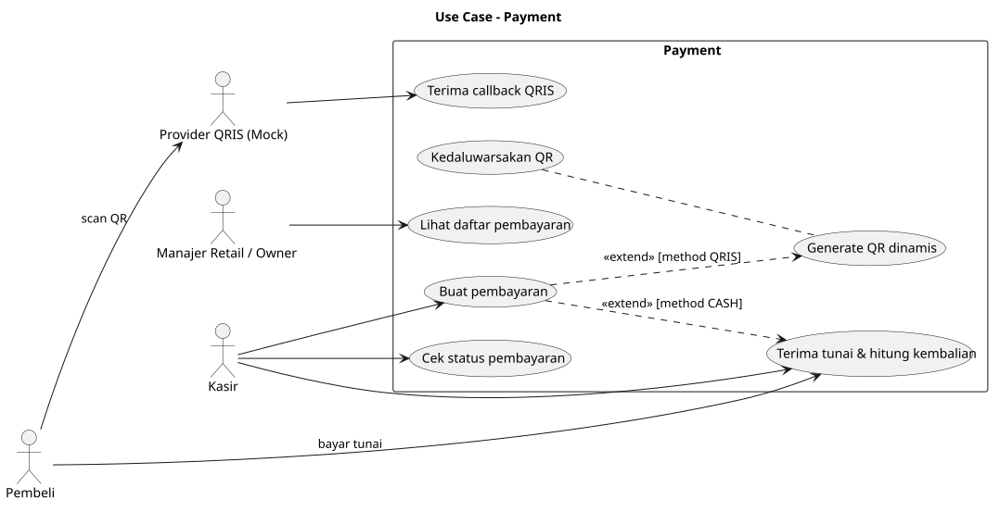

# SRS — ms_03 Payment

## 1. Fungsi
Memproses pembayaran penjualan retail dengan dua metode: **tunai** (hitung kembalian) dan **QRIS** (QR dinamis, disimulasikan oleh mock provider internal). Menerbitkan hasil pembayaran sebagai event.

## 2. Kebutuhan
- Satu `payment` per `sale_id` (unik); idempotensi lewat header `Idempotency-Key`.
- Tunai: `received_amount >= amount`, kembalian = selisih.
- QRIS: menghasilkan `qr_payload` dengan masa berlaku 5 menit; callback ber-signature HMAC; callback ganda tidak memproses ulang.
- Job kedaluwarsa menandai QRIS `EXPIRED` dan menerbitkan `payment.failed`.
- Pembayaran PAID tidak dapat diubah (hanya refund pada pengembangan lanjutan).

## 3. Endpoint

| Method | Path | Deskripsi | Peran |
|---|---|---|---|
| POST | `/payments` | Buat pembayaran `{sale_id, retail_id, method, amount}` | CASHIER (via Retail) |
| POST | `/payments/{id}/cash` | Konfirmasi tunai `{received_amount}` | CASHIER |
| GET | `/payments/{id}` | Status pembayaran | CASHIER, RETAIL_MANAGER, OWNER |
| POST | `/payments/qris/callback` | Callback provider (signature) | publik terverifikasi |
| POST | `/payments/{id}/qris/simulate` | Simulasi scan & bayar (hanya non-produksi) | CASHIER/dev |
| GET | `/payments` | Daftar (filter retail, tanggal, metode) | OWNER, RETAIL_MANAGER |

## 4. Model Data
`payments`, `cash_payments`, `qris_transactions` — lihat [er.puml](er.puml).

## 5. Event
Publish: `payment.paid`, `payment.failed`. Consume: tidak ada.

## 6. Diagram
[usecase.puml](usecase.puml) · [er.puml](er.puml) · [sequence_cash.puml](sequence_cash.puml) · [sequence_qris.puml](sequence_qris.puml) · [state_payment.puml](state_payment.puml)

## 7. Cara Pembuatan
1. Database `db_payment`; migrasi `payments` (unik `sale_id`), `cash_payments`, `qris_transactions`.
2. Interface `QRISProvider` dengan implementasi `MockQRISProvider` (generate payload, simulasi callback); sehingga mudah diganti provider nyata.
3. Service: mesin status pembayaran, validasi nominal, penanganan idempotensi.
4. Handler REST + verifikasi HMAC pada callback (`QRIS_SECRET`).
5. Publisher event dengan outbox: simpan event dalam transaksi yang sama dengan perubahan status.
6. Worker kedaluwarsa (ticker tiap 30 detik).
7. Uji: tunai kurang bayar, callback ganda, signature salah, QR kedaluwarsa.

## Lampiran Gambar Diagram

### ER - Payment

Sumber: [er.puml](er.puml)

### Sequence - Pembayaran Tunai

Sumber: [sequence_cash.puml](sequence_cash.puml)

### Sequence - Pembayaran QRIS (Mock Provider)

Sumber: [sequence_qris.puml](sequence_qris.puml)

### State - Payment

Sumber: [state_payment.puml](state_payment.puml)

### Use Case - Payment

Sumber: [usecase.puml](usecase.puml)
