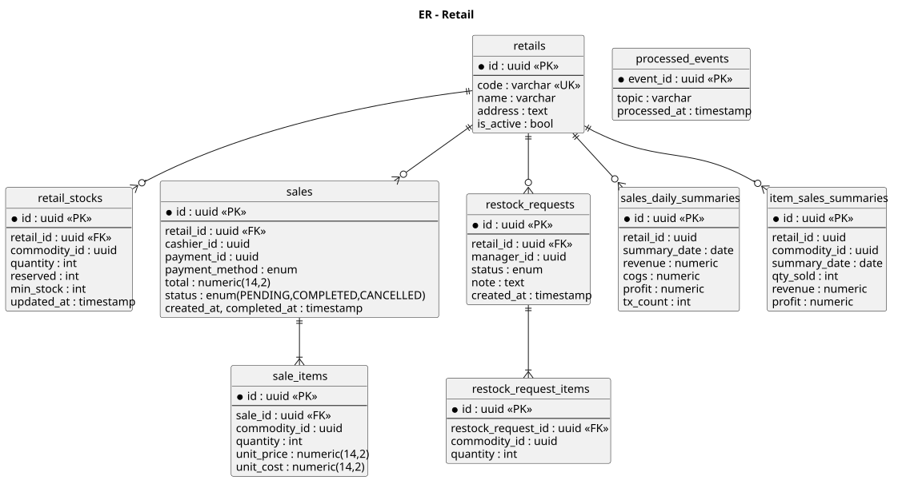
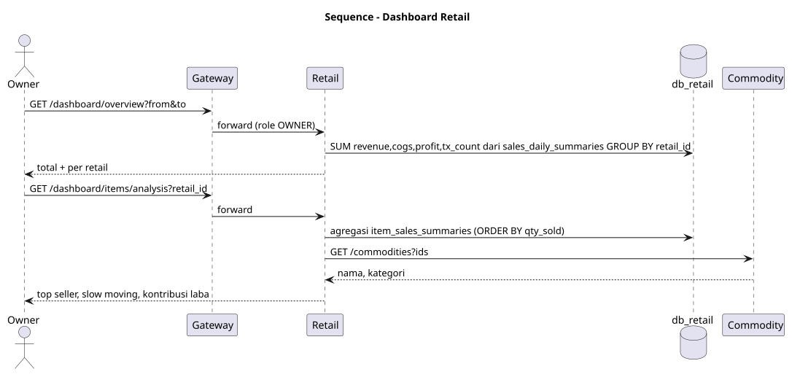
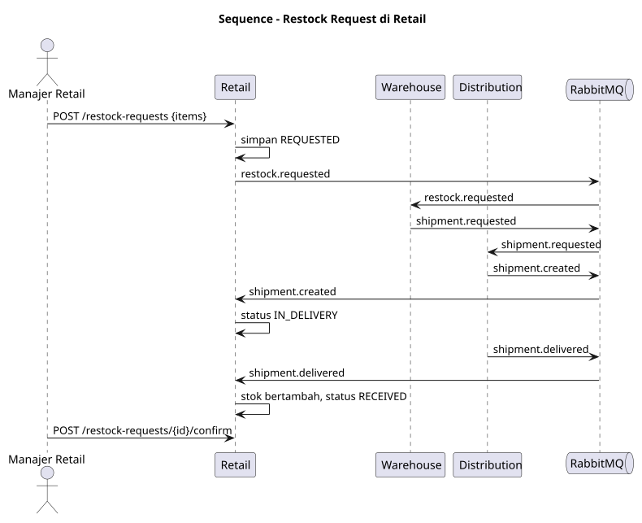
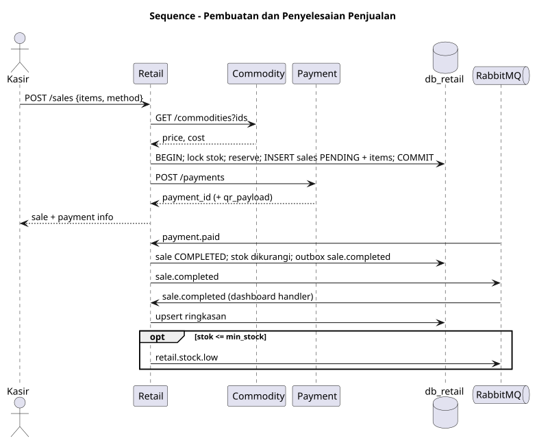
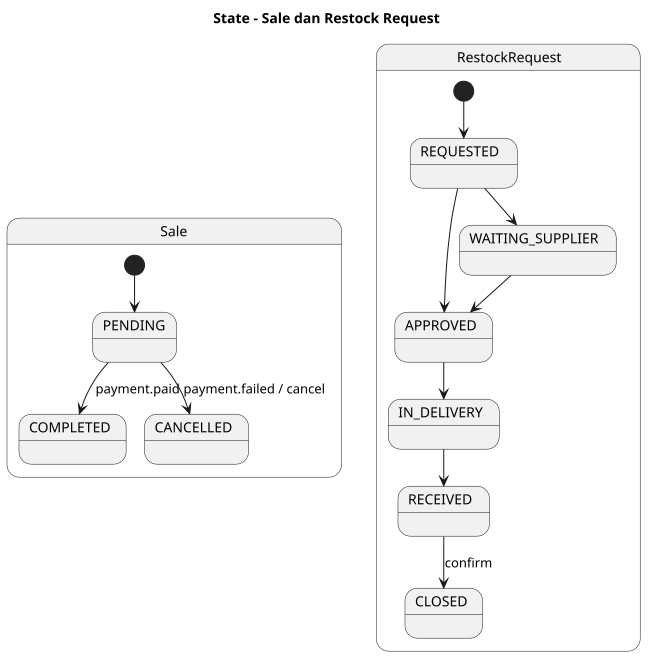
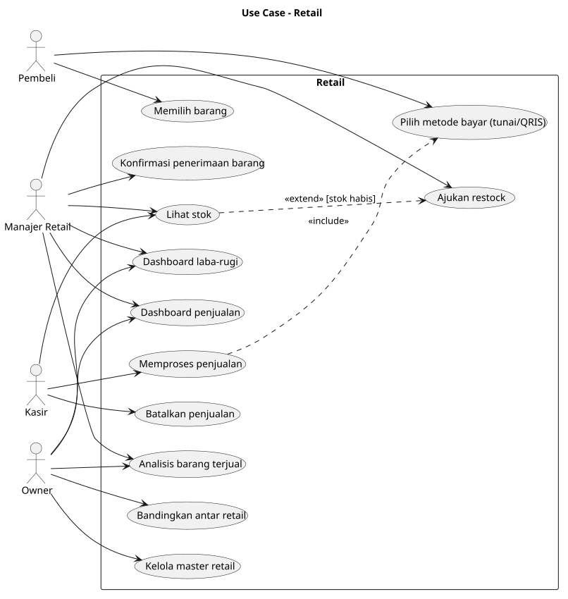

# SRS — ms_04 Retail

## 1. Fungsi
Service inti sisi toko: **POS/penjualan**, **stok retail**, **permintaan restock** ke warehouse, penerimaan barang distribusi, serta **dashboard** (penjualan, laba-rugi, analisis barang) berbasis read model.

## 2. Kebutuhan
- Master retail (cabang) dan stok per barang dengan `min_stock`.
- Penjualan multi-item: validasi stok, snapshot `unit_price` dan `unit_cost` dari Commodity, reserve stok saat PENDING.
- Sale menjadi COMPLETED setelah event `payment.paid`; CANCELLED setelah `payment.failed` (reservasi dilepas).
- Saat stok ≤ `min_stock` menerbitkan `retail.stock.low`; stok habis ditolak saat penjualan.
- Manajer membuat `restock_requests`; menerima barang saat `shipment.delivered` (stok bertambah) lalu konfirmasi.
- Dashboard (peran OWNER: semua retail; RETAIL_MANAGER: retailnya):
  - penjualan harian/bulanan, jumlah transaksi, rata-rata nilai transaksi;
  - laba-rugi = pendapatan − HPP (`cogs`), keseluruhan dan per retail;
  - analisis barang: terlaris, lambat laku, kontribusi laba, per kategori.

## 3. Endpoint

| Method | Path | Deskripsi | Peran |
|---|---|---|---|
| CRUD | `/retails` | Master retail | OWNER |
| GET | `/stocks` | Stok retail | CASHIER, RETAIL_MANAGER |
| POST | `/sales` | Buat penjualan | CASHIER |
| GET | `/sales`, `/sales/{id}` | Riwayat/detail | CASHIER, RETAIL_MANAGER, OWNER |
| POST | `/sales/{id}/cancel` | Batalkan sale PENDING | CASHIER |
| POST | `/restock-requests` | Ajukan restock | RETAIL_MANAGER |
| GET | `/restock-requests` | Daftar/status | RETAIL_MANAGER, OWNER |
| POST | `/restock-requests/{id}/confirm` | Konfirmasi penerimaan | RETAIL_MANAGER |
| GET | `/dashboard/overview` | Ringkasan penjualan & laba-rugi (`from`,`to`,`retail_id`) | OWNER, RETAIL_MANAGER |
| GET | `/dashboard/retails/{id}/profit-loss` | Laba-rugi per retail | OWNER, RETAIL_MANAGER |
| GET | `/dashboard/retails/compare` | Perbandingan antar retail | OWNER |
| GET | `/dashboard/items/analysis` | Analisis barang terjual | OWNER, RETAIL_MANAGER |

## 4. Model Data
`retails`, `retail_stocks`, `sales`, `sale_items`, `restock_requests`, `restock_request_items`, `sales_daily_summaries`, `item_sales_summaries` — lihat [er.puml](er.puml).

## 5. Event
- Publish: `sale.completed`, `retail.stock.low`, `restock.requested`.
- Consume: `payment.paid`, `payment.failed`, `shipment.created`, `shipment.delivered`, `sale.completed` (internal, pembaruan ringkasan dashboard).

## 6. Aturan Bisnis
- `profit = Σ (unit_price − unit_cost) × qty`; `cogs = Σ unit_cost × qty`.
- Pembaruan ringkasan idempoten (tabel `processed_events` berdasarkan `event_id`).
- Restock request hanya untuk retail milik manajer (cek `X-Retail-Id`).

## 7. Diagram
[usecase.puml](usecase.puml) · [er.puml](er.puml) · [sequence_sale.puml](sequence_sale.puml) · [sequence_restock.puml](sequence_restock.puml) · [sequence_dashboard.puml](sequence_dashboard.puml) · [state_sale_restock.puml](state_sale_restock.puml)

## 8. Cara Pembuatan
1. Database `db_retail`; migrasi seluruh tabel + `processed_events`, `outbox_events`; indeks `(retail_id, created_at)` pada `sales`, unik `(retail_id, summary_date)` pada ringkasan.
2. Modul stok: `Reserve`, `Release`, `Deduct`, `Add` dengan `SELECT … FOR UPDATE` agar tidak oversell.
3. Modul penjualan: client Commodity & Payment (timeout + retry), mesin status sale.
4. Consumer event + publisher (outbox).
5. Modul restock request.
6. Modul dashboard: handler `sale.completed` mengisi `sales_daily_summaries` dan `item_sales_summaries`; endpoint membaca tabel ringkasan, lalu memperkaya nama barang via Commodity.
7. Uji: concurrency stok, idempotensi event, perhitungan laba-rugi, otorisasi per retail.

## Lampiran Gambar Diagram

### ER - Retail

Sumber: [er.puml](er.puml)

### Sequence - Dashboard Retail

Sumber: [sequence_dashboard.puml](sequence_dashboard.puml)

### Sequence - Restock Request di Retail

Sumber: [sequence_restock.puml](sequence_restock.puml)

### Sequence - Pembuatan dan Penyelesaian Penjualan

Sumber: [sequence_sale.puml](sequence_sale.puml)

### State - Sale dan Restock Request

Sumber: [state_sale_restock.puml](state_sale_restock.puml)

### Use Case - Retail

Sumber: [usecase.puml](usecase.puml)
