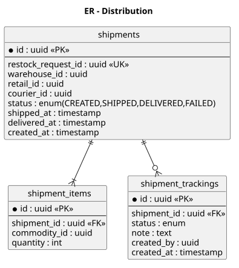
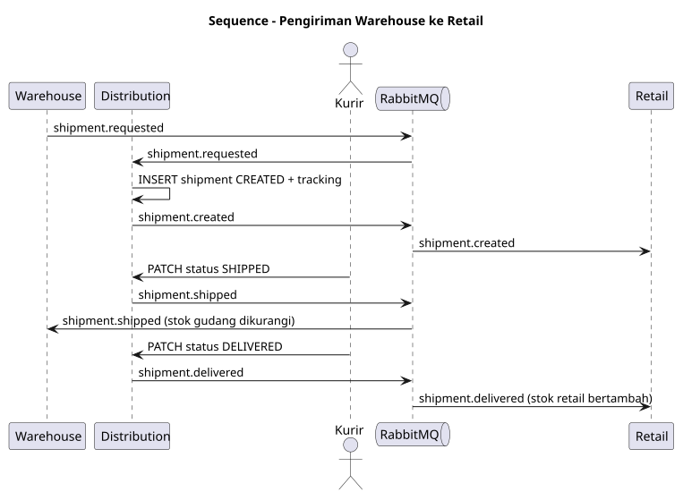
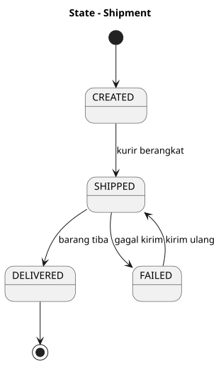
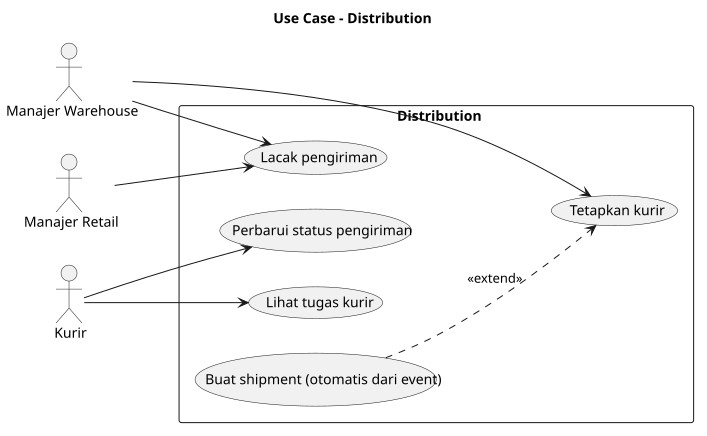

# SRS — ms_05 Distribution

## 1. Fungsi
Mengelola pengiriman barang dari **warehouse ke retail** untuk memenuhi restock request: pembuatan shipment, penugasan kurir, pelacakan status, dan pemberitahuan kedatangan.

## 2. Kebutuhan
- Shipment dibuat otomatis dari event `shipment.requested` (idempoten per `restock_request_id`).
- Status: `CREATED → SHIPPED → DELIVERED` (atau `FAILED`); setiap perubahan dicatat di `shipment_trackings`.
- Kurir memperbarui status; admin/manajer warehouse dapat menugaskan kurir.
- Penerbitan event setiap perubahan status penting.

## 3. Endpoint

| Method | Path | Deskripsi | Peran |
|---|---|---|---|
| GET | `/shipments` | Daftar (filter status, retail, warehouse) | WAREHOUSE_MANAGER, RETAIL_MANAGER, OWNER |
| GET | `/shipments/{id}` | Detail + tracking | idem + COURIER |
| PATCH | `/shipments/{id}/assign` | Tetapkan kurir | WAREHOUSE_MANAGER |
| PATCH | `/shipments/{id}/status` | Ubah status `{status, note}` | COURIER |
| GET | `/couriers/me/shipments` | Tugas kurir | COURIER |

## 4. Model Data
`shipments`, `shipment_items`, `shipment_trackings` — lihat [er.puml](er.puml).

## 5. Event
- Consume: `shipment.requested`.
- Publish: `shipment.created`, `shipment.shipped`, `shipment.delivered`, `shipment.failed`.

## 6. Diagram
[usecase.puml](usecase.puml) · [er.puml](er.puml) · [sequence_shipment.puml](sequence_shipment.puml) · [state_shipment.puml](state_shipment.puml)

## 7. Cara Pembuatan
1. Database `db_distribution`; migrasi tiga tabel + `processed_events`, `outbox_events`; unik `restock_request_id`.
2. Consumer `shipment.requested` → buat shipment + tracking awal dalam satu transaksi.
3. Mesin status dengan validasi transisi; publisher event via outbox.
4. Handler REST dan pembatasan akses kurir hanya pada shipment miliknya.
5. Uji: event ganda, transisi ilegal, otorisasi kurir.

## Lampiran Gambar Diagram

### ER - Distribution

Sumber: [er.puml](er.puml)

### Sequence - Pengiriman Warehouse ke Retail

Sumber: [sequence_shipment.puml](sequence_shipment.puml)

### State - Shipment

Sumber: [state_shipment.puml](state_shipment.puml)

### Use Case - Distribution

Sumber: [usecase.puml](usecase.puml)
