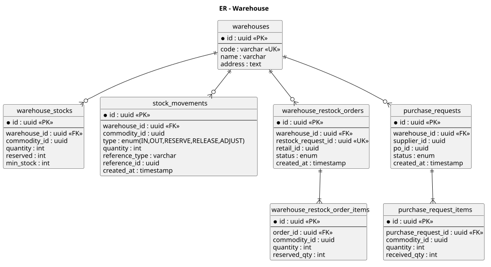
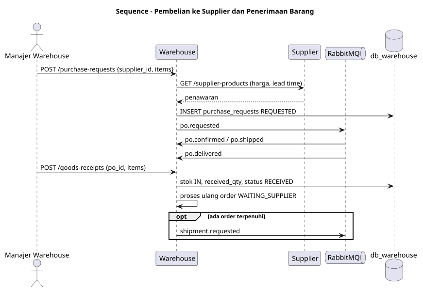
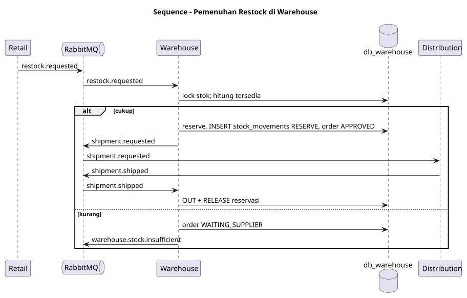
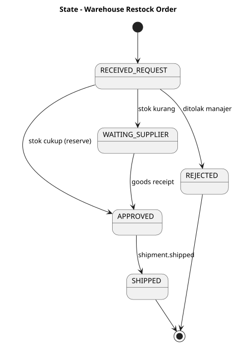
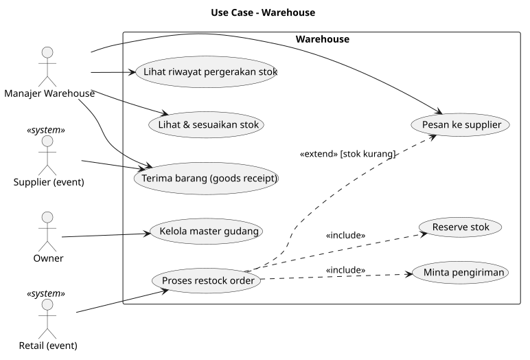

# SRS — ms_06 Warehouse

## 1. Fungsi
Mengelola **stok gudang**, memenuhi restock request dari retail (reservasi stok lalu meminta pengiriman), dan **memesan barang ke supplier** ketika stok gudang tidak cukup, termasuk penerimaan barang (goods receipt).

## 2. Kebutuhan
- Stok per barang: `quantity`, `reserved`, `min_stock`; tersedia = `quantity − reserved`.
- Setiap perubahan stok tercatat di `stock_movements` (IN/OUT/RESERVE/RELEASE) — jejak audit.
- Terima `restock.requested`: bila stok cukup → reserve + `shipment.requested`; bila kurang → `WAITING_SUPPLIER` + `warehouse.stock.insufficient`.
- Pembelian ke supplier: manajer membuat purchase request → event `po.requested`.
- Goods receipt saat PO delivered menambah stok, lalu memproses ulang order yang menunggu.
- Saat `shipment.shipped`, stok dikurangi (OUT) dan reservasi dilepas.

## 3. Endpoint

| Method | Path | Deskripsi | Peran |
|---|---|---|---|
| CRUD | `/warehouses` | Master gudang | OWNER |
| GET | `/stocks` | Stok gudang | WAREHOUSE_MANAGER, OWNER |
| POST | `/stocks/adjustments` | Penyesuaian stok manual | WAREHOUSE_MANAGER |
| GET | `/stock-movements` | Riwayat pergerakan | WAREHOUSE_MANAGER |
| GET | `/restock-orders` | Order restock dari retail | WAREHOUSE_MANAGER |
| POST | `/restock-orders/{id}/reject` | Tolak order | WAREHOUSE_MANAGER |
| POST | `/purchase-requests` | Pesan ke supplier `{supplier_id, items}` | WAREHOUSE_MANAGER |
| GET | `/purchase-requests` | Status pemesanan | WAREHOUSE_MANAGER |
| POST | `/goods-receipts` | Terima barang `{po_id, items}` | WAREHOUSE_MANAGER |

## 4. Model Data
`warehouses`, `warehouse_stocks`, `stock_movements`, `warehouse_restock_orders`, `purchase_requests` — lihat [er.puml](er.puml).

## 5. Event
- Consume: `restock.requested`, `shipment.shipped`, `po.confirmed`, `po.shipped`, `po.delivered`.
- Publish: `shipment.requested`, `warehouse.stock.insufficient`, `po.requested`.

## 6. Diagram
[usecase.puml](usecase.puml) · [er.puml](er.puml) · [sequence_restock_fulfillment.puml](sequence_restock_fulfillment.puml) · [sequence_purchase_supplier.puml](sequence_purchase_supplier.puml) · [state_restock_order.puml](state_restock_order.puml)

## 7. Cara Pembuatan
1. Database `db_warehouse`; migrasi tabel + `processed_events`, `outbox_events`; `CHECK (reserved <= quantity)`.
2. Modul stok transaksional (`FOR UPDATE`), setiap operasi menulis `stock_movements`.
3. Consumer `restock.requested` dengan logika cukup/kurang (alokasi parsial opsional: kirim sebagian, sisa menunggu supplier).
4. Modul purchase request + consumer event PO.
5. Modul goods receipt (validasi jumlah vs PO) lalu pemicu pemrosesan ulang order menunggu.
6. Uji: reservasi bersamaan, event ganda, penerimaan parsial.

## Lampiran Gambar Diagram

### ER - Warehouse

Sumber: [er.puml](er.puml)

### Sequence - Pembelian ke Supplier dan Penerimaan Barang

Sumber: [sequence_purchase_supplier.puml](sequence_purchase_supplier.puml)

### Sequence - Pemenuhan Restock di Warehouse

Sumber: [sequence_restock_fulfillment.puml](sequence_restock_fulfillment.puml)

### State - Warehouse Restock Order

Sumber: [state_restock_order.puml](state_restock_order.puml)

### Use Case - Warehouse

Sumber: [usecase.puml](usecase.puml)
