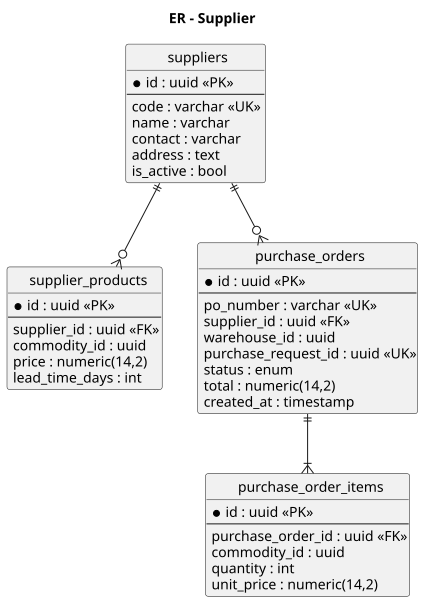
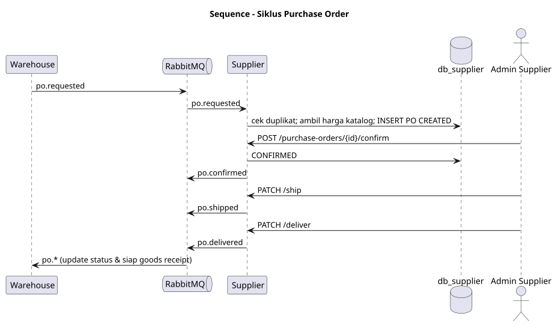
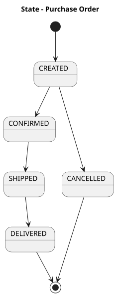
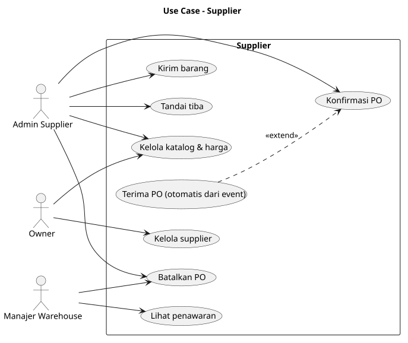

# SRS — ms_07 Supplier

## 1. Fungsi
Mengelola **master supplier**, katalog produk & harga pemasok, dan siklus **purchase order (PO)** dari permintaan warehouse hingga barang dikirim/diterima.

## 2. Kebutuhan
- CRUD supplier; katalog `supplier_products` (barang, harga, lead time).
- PO dibuat otomatis dari event `po.requested` (idempoten).
- Admin supplier mengonfirmasi, mengirim, dan menandai PO terkirim; tiap perubahan menerbitkan event.
- Admin supplier hanya melihat PO miliknya (`X-Supplier-Id`).
- Pembatalan PO hanya saat status `CREATED`.

## 3. Endpoint

| Method | Path | Deskripsi | Peran |
|---|---|---|---|
| CRUD | `/suppliers` | Master supplier | OWNER |
| CRUD | `/supplier-products` | Katalog & harga | OWNER, SUPPLIER_ADMIN |
| GET | `/supplier-products?commodity_id=` | Penawaran per barang | WAREHOUSE_MANAGER |
| GET | `/purchase-orders`, `/{id}` | Daftar/detail PO | SUPPLIER_ADMIN, WAREHOUSE_MANAGER, OWNER |
| POST | `/purchase-orders/{id}/confirm` | Konfirmasi | SUPPLIER_ADMIN |
| PATCH | `/purchase-orders/{id}/ship` | Tandai dikirim | SUPPLIER_ADMIN |
| PATCH | `/purchase-orders/{id}/deliver` | Tandai tiba | SUPPLIER_ADMIN |
| POST | `/purchase-orders/{id}/cancel` | Batalkan | SUPPLIER_ADMIN, WAREHOUSE_MANAGER |

## 4. Model Data
`suppliers`, `supplier_products`, `purchase_orders`, `purchase_order_items` — lihat [er.puml](er.puml).

## 5. Event
- Consume: `po.requested`.
- Publish: `po.confirmed`, `po.shipped`, `po.delivered`, `po.cancelled`.

## 6. Diagram
[usecase.puml](usecase.puml) · [er.puml](er.puml) · [sequence_purchase_order.puml](sequence_purchase_order.puml) · [state_purchase_order.puml](state_purchase_order.puml)

## 7. Cara Pembuatan
1. Database `db_supplier`; migrasi empat tabel + `processed_events`, `outbox_events`; unik `(supplier_id, commodity_id)`.
2. CRUD supplier & katalog.
3. Consumer `po.requested` → buat PO, harga diambil dari `supplier_products` (snapshot `unit_price`).
4. Mesin status PO + publisher event (outbox).
5. Pembatasan akses per `supplier_id`.
6. Uji: transisi ilegal, event ganda, otorisasi lintas supplier.

## Lampiran Gambar Diagram

### ER - Supplier

Sumber: [er.puml](er.puml)

### Sequence - Siklus Purchase Order

Sumber: [sequence_purchase_order.puml](sequence_purchase_order.puml)

### State - Purchase Order

Sumber: [state_purchase_order.puml](state_purchase_order.puml)

### Use Case - Supplier

Sumber: [usecase.puml](usecase.puml)
